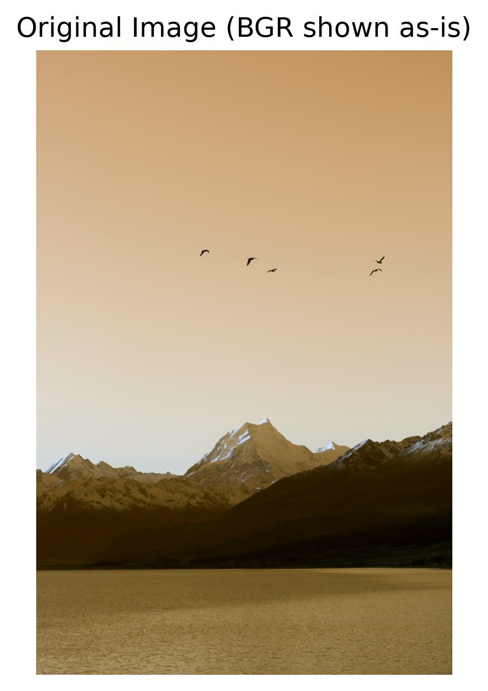
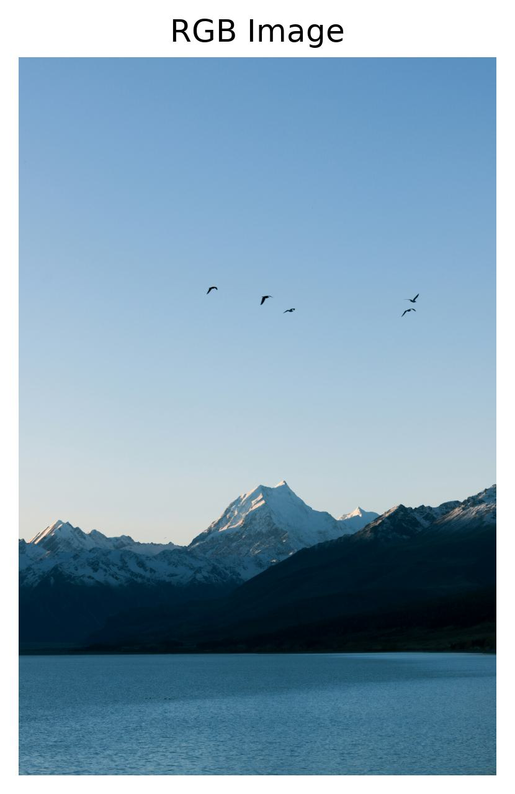
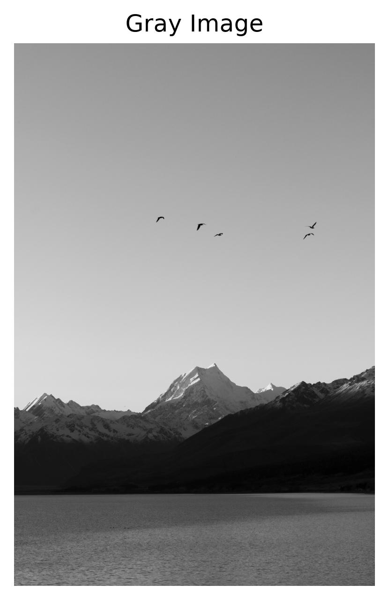
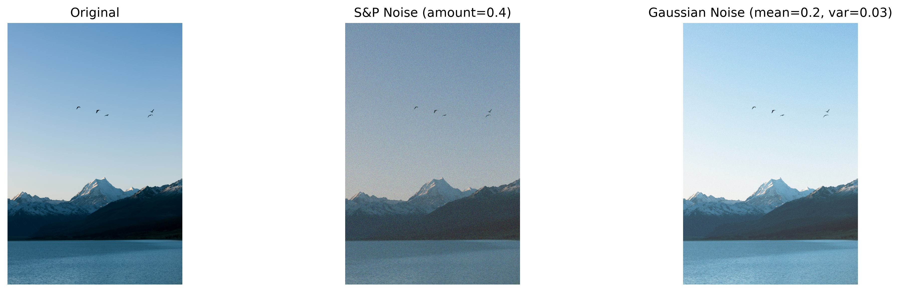
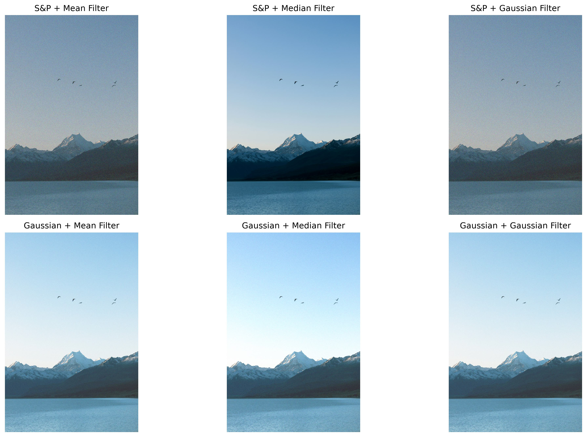
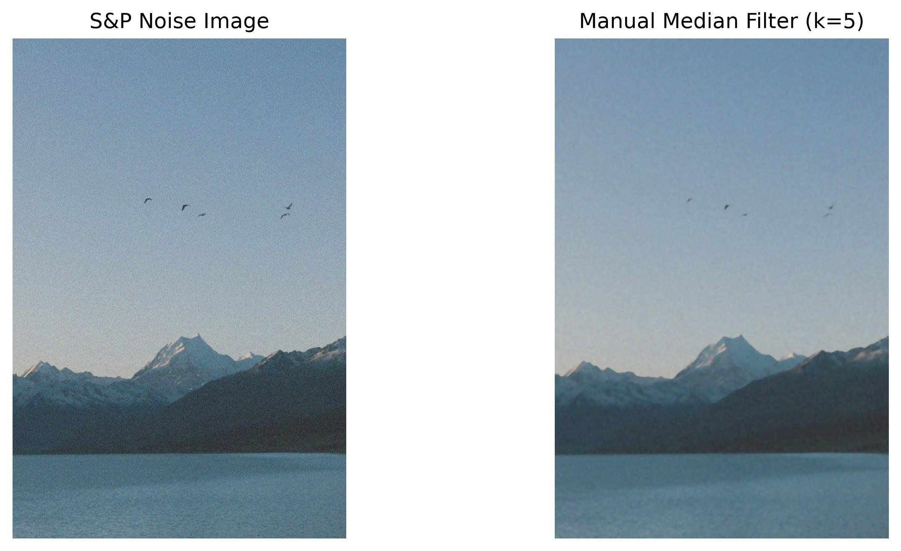

# 实验二 图像增强

本实验基于 OpenCV 完成彩色图像的读取、色彩空间转换、噪声添加与多种滤波去噪，并手动实现彩色图像的中值滤波，最后对比分析不同噪声类型与滤波方法的适用性。


| 姓名 | 卢嘉伟 |
| 学号 | 202410315023 |
| 专业班级 | 人工智能241 |


## 一、实验目的

1. 掌握 OpenCV 读取、显示与保存图像的基本方法；
2. 理解 BGR、RGB、灰度等常用色彩空间及其相互转换关系；
3. 掌握椒盐噪声与高斯噪声的生成方法，理解两类噪声的成因与表现差异；
4. 掌握均值滤波、中值滤波、高斯滤波的原理与 OpenCV 实现；
5. 能够手动实现彩色图像的中值滤波，并与 OpenCV 内置结果进行对比；
6. 学会根据噪声类型选择合适的滤波方法，完成图像的增强与去噪。

## 二、实验环境

| 项目 | 说明 |
| --- | --- |
| 操作系统 | Windows 10/11 |
| 开发环境 | Anaconda + Jupyter Notebook（`cv` 环境） |
| 编程语言 | Python 3.11.0 |
| OpenCV | 5.0.0（opencv-python） |
| NumPy | 2.0.1 |
| scikit-image | 0.26.0 |
| Matplotlib | 3.11.2 |

依赖安装命令：

```bash
pip install opencv-python scikit-image numpy matplotlib jupyter
```

## 三、实验原理

### 3.1 色彩空间与通道顺序

OpenCV 的 `cv2.imread` 默认按 **BGR** 顺序读取三通道图像，而 Matplotlib 按 **RGB** 顺序显示，因此直接显示会出现红蓝互换。使用 `cv2.cvtColor(img, cv2.COLOR_BGR2RGB)` 交换 B、R 通道后即可正常显示。`cv2.COLOR_BGR2GRAY` 则按亮度加权公式把三通道压缩为一维灰度：

```text
Y = 0.299R + 0.587G + 0.114B
```

### 3.2 噪声模型

- **椒盐噪声（Salt & Pepper）**：以一定概率把像素随机置为最亮或最暗值，表现为孤立的白色/黑色噪点，属于突变型、稀疏噪声；在彩色图中表现为随机彩色噪点。`amount=0.4` 表示约 40% 的像素被污染。
- **高斯噪声（Gaussian）**：对每个像素叠加服从高斯分布的随机偏差，属于连续型、全局噪声，整体表现为亮度抖动、细节轻微模糊。

### 3.3 滤波方法

- **均值滤波**：用邻域像素的平均值代替中心像素，属于线性平滑，计算简单、速度快，但会模糊边缘；
- **中值滤波**：用邻域像素的中值代替中心像素，属于非线性滤波，对椒盐这类极端值不敏感，去脉冲噪声效果好且能较好保留边缘；
- **高斯滤波**：按二维高斯函数对邻域加权平均，中心权重最大，平滑效果自然，适合抑制高斯噪声。

## 四、实验内容与步骤

### 4.1 导入依赖库

```python
import cv2
import numpy as np
from skimage.util import random_noise
from matplotlib import pyplot as plt
```

### 4.2 读取原始图像并转换色彩空间

读取本地图像 `p1.jpg`，输出 `[100,100]` 像素的 BGR 参数，并分别保存原始图、RGB 图和灰度图。

```python
img = cv2.imread('p1.jpg')          # 默认 BGR
b, g, r = img[100, 100]             # 取 [100,100] 像素的 BGR
print(b, g, r)

rgb_img  = cv2.cvtColor(img, cv2.COLOR_BGR2RGB)    # 红蓝通道互换
gray_img = cv2.cvtColor(img, cv2.COLOR_BGR2GRAY)   # 转灰度
```







参考文档中该像素的 BGR 为 (82, 86, 241)，整体偏蓝，对应猫衣服的深蓝色区域；BGR→RGB 后红蓝通道归位，颜色符合人眼认知；灰度图保留亮度结构，便于后续处理。

### 4.3 添加噪声

在原始图像上分别添加椒盐噪声和高斯噪声，并做 1×3 对比图。

```python
# 椒盐噪声：约 40% 的像素被置为黑/白（彩色图中为随机彩色点）
sp_noise_img = random_noise(rgb_img, mode='s&p', amount=0.4)

# 高斯噪声：每个像素叠加均值 0.2、方差 0.03 的高斯偏差
gus_noise_img = random_noise(rgb_img, mode='gaussian', mean=0.2, var=0.03)
```



### 4.4 三种滤波方法对比

对椒盐噪声图和高斯噪声图分别使用均值滤波、中值滤波、高斯滤波，组成 2×3 对比图。

```python
sp_u8  = (sp_noise_img  * 255).astype(np.uint8)
gus_u8 = (gus_noise_img * 255).astype(np.uint8)

mean_sp  = cv2.blur(sp_u8, (5, 5))
mid_sp   = cv2.medianBlur(sp_u8, 5)
gauss_sp = cv2.GaussianBlur(sp_u8, (5, 5), 0)

mean_gus  = cv2.blur(gus_u8, (5, 5))
mid_gus   = cv2.medianBlur(gus_u8, 5)
gauss_gus = cv2.GaussianBlur(gus_u8, (5, 5), 0)
```



### 4.5 手动实现彩色图像的中值滤波

实现思路：彩色图有 R、G、B 三个通道，需要**逐通道**处理；先对每个通道做边缘填充（`np.pad(mode='edge')`），避免边界越界，再以 `kernel_size × kernel_size` 的窗口滑动，取窗口内像素的中值作为输出。代码中使用 `sliding_window_view` 做向量化滑窗，算法与逐像素双重循环完全一致，但运行速度更快。

由于手机照片尺寸较大，直接做 5×5 滑窗会占用大量内存，代码先把图缩放到**最长边 800 像素**再滤波，并与同尺寸的 `cv2.medianBlur` 结果对比验证。

```python
def manual_median_filter_color(image, kernel_size=5):
    """手动实现彩色图像中值滤波"""
    pad = kernel_size // 2
    out = np.zeros_like(image)
    for c in range(image.shape[2]):          # 逐通道处理
        padded = np.pad(image[:, :, c], pad, mode='edge')
        windows = np.lib.stride_tricks.sliding_window_view(
            padded, (kernel_size, kernel_size))
        out[:, :, c] = np.median(windows, axis=(-2, -1))
    return out

manual_mid = manual_median_filter_color(sp_u8, 5)
```



## 五、实验结果与分析

### 5.1 原始图像与色彩空间转换

通过 OpenCV 读取图像并显示，可以清楚看到原始彩色图像的细节。由于 `imread` 按 BGR 读入，直接用 Matplotlib 显示时红蓝通道是互换的；转换为 RGB 后颜色恢复正常，说明通道顺序对显示结果影响很大。灰度图把三维的 RGB 通道映射为一维亮度通道，突出图像的明暗结构，为后续噪声与滤波处理提供了更简洁的输入。

### 5.2 噪声添加效果

- **椒盐噪声**：图像中随机出现黑白点（彩色图中表现为彩色噪点），部分区域被明显破坏，属于局部、突变的干扰；
- **高斯噪声**：整幅图像亮度轻微抖动，噪声分布均匀、连续，整体细节略显模糊。

对比可见，椒盐噪声的局部破坏更明显，高斯噪声则更多影响全局视觉效果，两者在成因和形态上有本质区别。

### 5.3 滤波去噪效果

**均值滤波**：对高斯噪声的去除效果较好，能平滑整幅图像；但对椒盐噪声只能把噪点“抹匀”，尖锐黑白点去除不彻底，且容易造成边缘模糊。

**中值滤波（`cv2.medianBlur`）**：对椒盐噪声的去除效果显著，能有效保留图像边缘和细节；对高斯噪声也有一定抑制作用，但整体效果略逊于均值滤波。

**高斯滤波（`cv2.GaussianBlur`）**：对高斯噪声的去除效果最佳，平滑自然，并保留了一定边缘信息；但对椒盐噪声的处理能力有限，因为椒盐噪声是突变值，而高斯核是连续加权。

### 5.4 手动中值滤波

手动实现的中值滤波效果与 OpenCV 自带的 `cv2.medianBlur` 基本一致，能够有效去除彩色图像中的椒盐噪声，并保持颜色真实、边缘清晰。实验验证了处理彩色图像时应当对 R、G、B 三个通道分别滤波的合理性；同时也说明中值滤波的核心只是“排序取中值”，实现并不复杂，但窗口越大计算量越大，实际工程中可用直方图或快速选择算法优化。

### 5.5 综合分析

| 噪声类型 | 噪声特点 | 最适合的滤波方法 | 原因 |
| --- | --- | --- | --- |
| 椒盐噪声 | 孤立黑白/彩色噪点，突变、稀疏 | 中值滤波 | 中值不受极端值影响，去脉冲噪声的同时能保留边缘 |
| 高斯噪声 | 全局小幅随机偏差，连续分布 | 均值滤波 / 高斯滤波 | 线性平滑可有效抑制零均值随机噪声，高斯核更自然 |

总体来看：**椒盐噪声适合用中值滤波，高斯噪声适合用均值滤波或高斯滤波**。手动实现的彩色中值滤波不仅复现了 OpenCV 的滤波效果，还加深了对滤波原理和通道处理方式的理解，为后续自定义滤波与算法优化打下基础。

## 六、实验小结

本实验完成了彩色图像的读取、BGR→RGB 转换和灰度图显示，并在原图基础上添加了椒盐噪声与高斯噪声；随后分别用均值滤波、中值滤波、高斯滤波以及手动实现的中值滤波对噪声图像进行去噪，并对结果进行了对比分析。

实验结果表明：

1. 中值滤波对椒盐噪声的去除效果最为显著，能有效保留边缘和细节；
2. 均值滤波更适合高斯噪声的平滑去除，但会带来边缘模糊；
3. 高斯滤波对高斯噪声效果最佳，平滑自然；
4. 手动实现的彩色中值滤波与 OpenCV 结果基本一致，说明彩色图像需要按通道分别滤波。

通过本次实验，进一步理解了图像噪声的类型与滤波原理，掌握了手动实现彩色图像中值滤波的方法，为后续图像去噪与滤波算法的改进和优化奠定了基础。

## 七、文件说明

```text
2nd.exp/
├── code.ipynb        # 实验代码（Jupyter Notebook）
├── README.md         # 实验报告（本文件）
├── requirements.txt  # 依赖清单
├── 操作说明.md        # 运行与上传 GitHub 的步骤
├── p1.jpg            # 输入图像（自行放入）
└── result/           # 运行后生成的对比图
    ├── original_bgr.jpg
    ├── rgb_image.jpg
    ├── gray_image.jpg
    ├── noise_comparison.jpg
    ├── filter_results_2x3.jpg
    └── manual_median.jpg
```

运行方法见 [操作说明.md](操作说明.md)。
